**Лабораторная работа №2**

Тема: Substance Painter
Цель: Изучить возможности Substance Painter

Рассчитано на кол-во пар: 2

___

#### Немного теории
Определения:
> *Ассет* (Asset) – любой файл или элемент данных, например *Игровой объект* (GameObject) или *Меш* (Mesh)
> *Игровой объект* (GameObject) – объект находящийся на сцене
> *Меш* (Mesh) – модель (к примеру та, что вы экспортируете из Blender'а)
> *Префаб* (Prefab) – шаблон для ассета

#### Что такое Substance?
Substance 3D Painter — это программа, которая позволяет в реальном времени создавать наборы текстурных карт для 3D-моделей. С её помощью художник может нарисовать текстуры вручную и сразу оценить результат.

> Проще говоря, Substance – это Photoshop для 3D-художников

#### Интерфейс программы

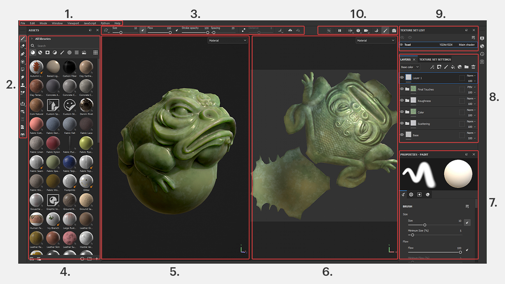

В самом верху находится **главное меню (№1)**. Его структура практически ничем не отличается от других редакторов или программ.

**Слева (№2)** расположена **панель инструментов для рисования**. Помимо неё, чуть ниже можно найти ярлыки для загрузки дополнительных ассетов. **Общие настройки кисти** или других выбранных инструментов можно отрегулировать на панели сверху **(на скриншоте — №3)**.

Чуть правее панели инструментов по умолчанию открыто окно **Assets (№4) — библиотека ассетов с готовыми материалами**, которые можно применить на объекте методом перетаскивания. Изначально в ней отображены все материалы, но при необходимости доступна сортировка по различным категориям.

Рядом находится окно с UV-развёрткой в 2D **(на скриншоте — №6)**. Все применённые к текстуре изменения будут также отображаться в 2D-проекции в реальном времени. Это удобно при ручной отрисовке: можно отследить направления мазков и их переходы на другой UV-остров.

Справа внизу **(на скриншоте — №7)** расположено окно Properties с расширенными настройками выбранного инструмента или слоя/маски.

Выше, во вкладке Layers **(№8)**, находятся задействованные в проекте слои и маски. Все они размещены в порядке иерархии, то есть по аналогии со слоями в графических редакторах. Рядом есть вкладка Texture Set Settings, где можно посмотреть информацию обо всех текстурных картах объекта.

В окне Texture Set List **(№9)** отображается список всех материалов, созданных для мешей модели. Например, у текущей модели жабы есть всего один материал, Toad. Но если мы, скажем, импортируем в программу FBX-модель какого-нибудь персонажа, то увидим гораздо больше материалов, количество которых будет варьироваться от сложности меша (материал для волос, головы, туловища и так далее). К слову, перед импортом собственной модели в Substance 3D Painter все материалы объекта желательно назначить заранее.
#### Управление
В центре расположен 3D-вьюпорт **(на скриншоте — №5)**. В нём можно рассмотреть модель со всех сторон, используя следующие горячие клавиши:

- **Alt + ЛКМ** — вращение;
- **Alt + ПКМ** — приближение/отдаление;
- **Alt + СКМ** — перемещение;
- **Shift + ПКМ** — перемещение источника освещения (чтобы рассмотреть, как материал реагирует на свет).

#### Много практики
Для начала создадим простую модель в Blender. Пусть это будет простая деревянная (или металлическая) коробка.
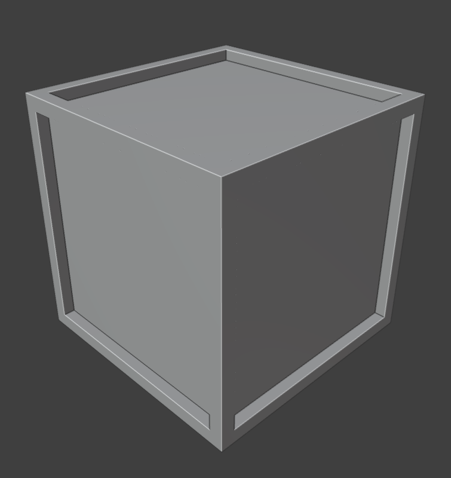

Сохраним её в формате *.fbx*.

Теперь, открываем Substacne Painter и открываем там нашу модель. Для этого выполняем следующие действия:
1. Нажимаем "File" -> "New"
2. Нажимаем "Select" и выбираем наш *.fbx* файл
3. Нажимаем "OK"
   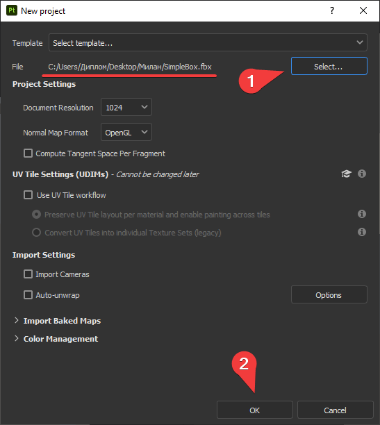

Вы должны увидеть следующее меню
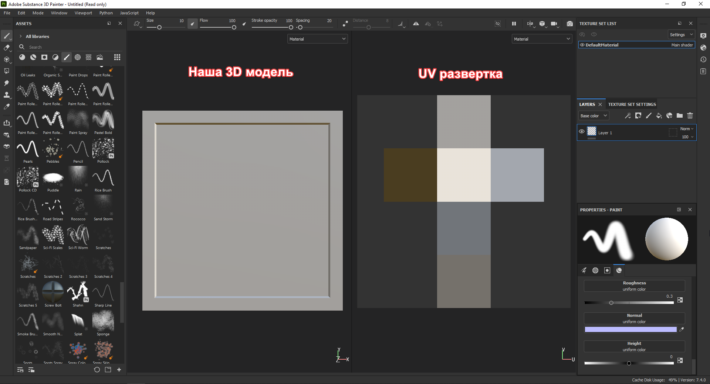

Воспользуйтесь горячими клавишами описанными в главе **Управление**.
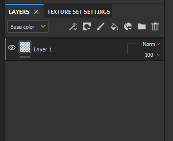
Обратим внимание на вкладку "Layers". Здесь всё как в Photoshop'е. К примеру, мы хотим окрасить нашу коробку материал дерева. Для этого перейдем в вкладку Assets, та что слева, и выберем там категорию Materials. Найдем там подходящий материал
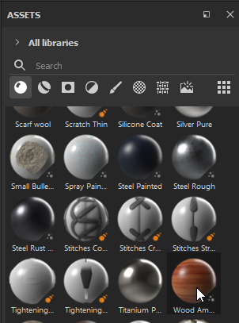
Перенесем материал на объект и тем самым создадим новый слой заливки
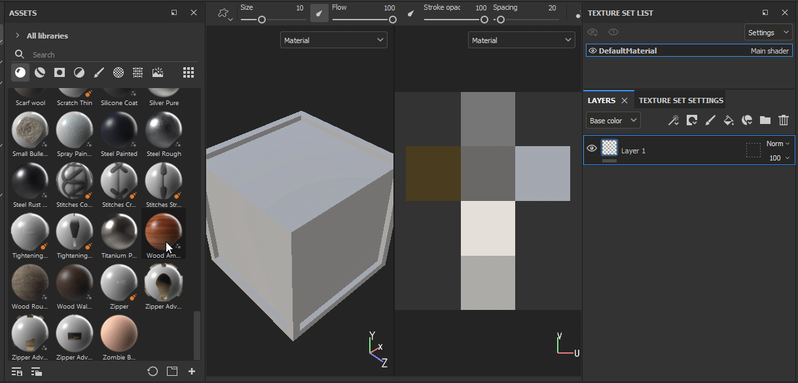

#### Немного о слоях
1. Слой для рисования. Иконка кисти
   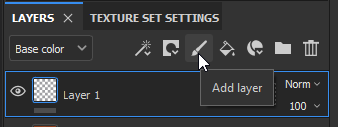
2. Слой заливка. Покрывает весь объект
   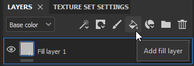
3. Маска. Дополнение к слою. Трафарет
   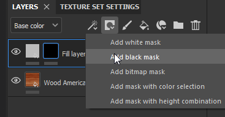
   Где маска белая – слой виден, а где чёрная – нет
   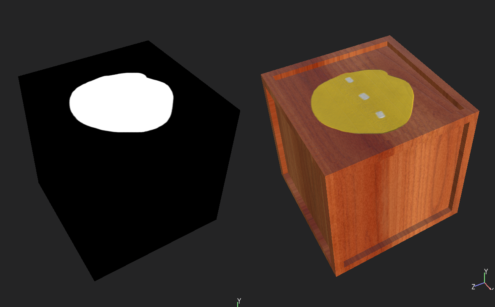

#### Как рисовать?
Рисовать можно только на слое для рисования и слое маски. Для начала посмотрим какая у нас выбрана кисть:
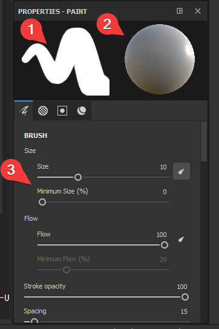
1. Вид кисти
2. Материал кисти
3. Размер (Size), Flow (Сила нажатия) и др. настройки

Мы можем изменить материал, которым мы рисуем:
- Либо выбрав его из списка Asset'ов
- Либо обозначив его самим

Для первого варианта нужно всего лишь нажать по желаемому материалу:
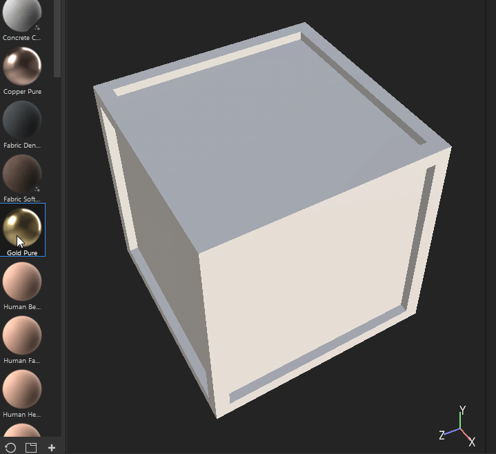

А для второго варианта, мы должно опуститься ниже во вкладке Properties справа снизу, дойдя до категории Material
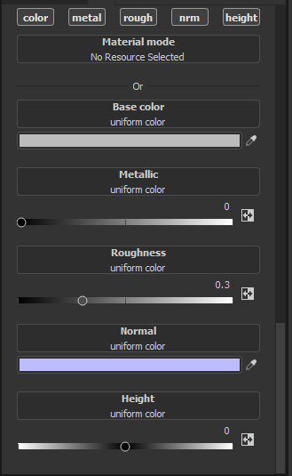
> **Важно!** чтоб в данный момент у вас не был выбран никакой материал. Если он есть во вкладке *Material mode* нажмите крестик
> 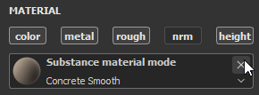

- Base Color – отвечает за цвет которым вы будете рисовать
- Metatilic – за степень того, насколько металлической будет ваша кисть
- Roughess – шероховатость. Чем меньше, тем более зеркальная поверхность
- Normal – лучше не трогать. Указывает направление
- Height – если число положительное, то кисть будет добавлять объем, а если отрицательное, то будет делать углубления

Если вы не хотите, чтоб ваша кисть рисовала чем либо из перечисленного, просто отключите параметры. Например, если отключить цвет (Base Color) и изменить параметр высоты (Height), то мы получим следующий результат.
> Рисовать можно как на 3D-модели, так и на UV-развертке

___

Критерии оценки
