**Лабораторная работа №3

Тема: Красим отдельные части в Substance Painter
Цель: Научиться отделать части для покраски в Substance Painter + Blender

Рассчитано на кол-во пар: 1

___

На прошлых занятиях мы научились использовать маски. Они помогают нам помечать зону текстуры, которая будет поддаваться изменениям. Однако выделять конкретные части модели с помощью маски достаточно сложно, приходятся делать это в ручную. Для того, чтобы упростить этот процесс – мы будем использовать разделение, сделанное прямо в Blender'е.

#### Blender

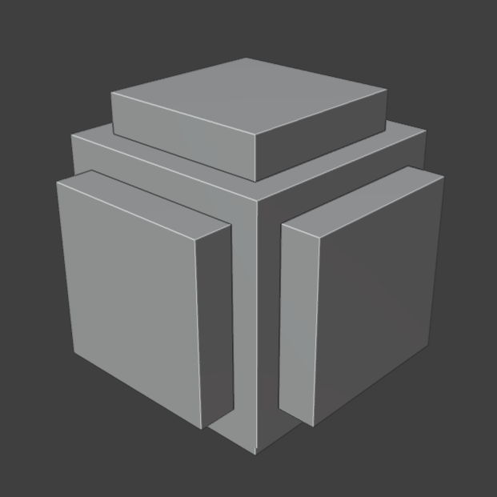

Для начала сделаем простую модель кубика с гранями.

Теперь нам нужно сделать для него правильную развертку. Поскольку грани куба у нас все по 90 градусов – мы можем использовать следующую фишку:
1. Перейдем в Edit Mode (TAB)
2. Выделим все острые грани с помощью *Select - Sharp Edges*
3. Пометим их как швы

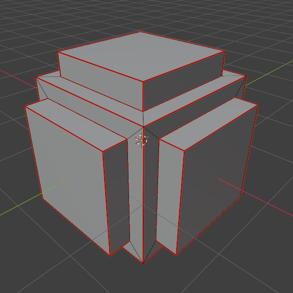

Должны получить следующее. Теперь сделаем развертку с помощью *Unwrap* в панели *UV Editing*. Слегка изменим параметр *Margin*, чтобы грани не слипались между собой

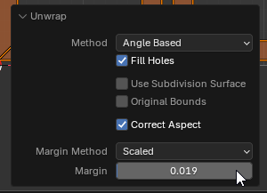

Допустим мы хотим, чтобы наши выступающие части в дальнейшем имели иной материал, чем другие части. Для этого выполним следующее.
1. Выделим все выступающие грани
   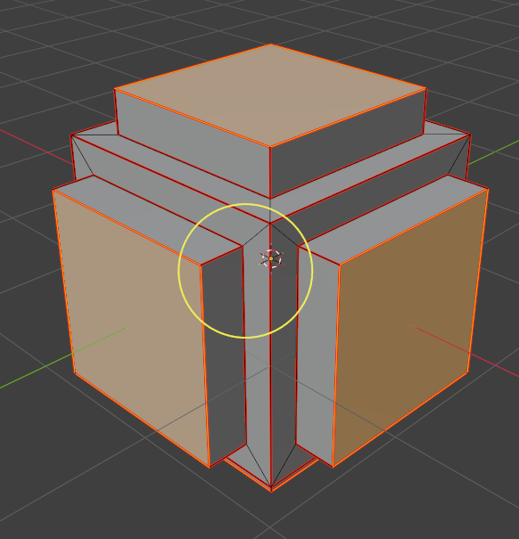
2. Нажмем *CTRL + Plus (плюсик на нумпаде, панели справа)*. У вас должны выделиться рядом стоящие грани.
3. Теперь перейдем в режим *Vertex Paint*
   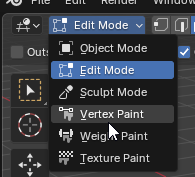
4. Выберите любой контрастный цвет, например ярко-красный, ярко-зеленый
   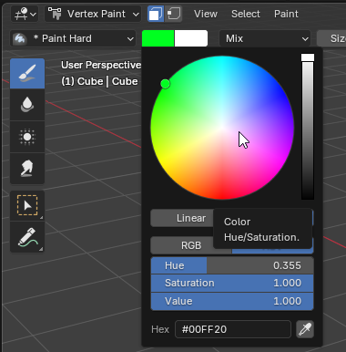
5. Обязательно включите режим *Face'ов*
   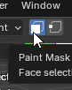
6. Нажмите *Paint* и выберите *Set Vertex Color*
   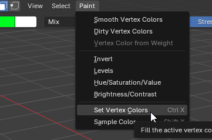
7. Должна получиться следующая картина
   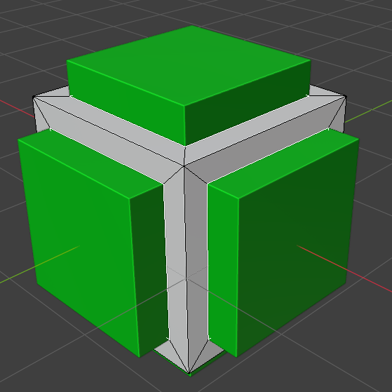

Мы покрасили наши Face'ы в зеленый цвет. Однако если вы перейдете в *Object Mode* и включите *Material Preview* вы не увидите изменений, поскольку эти изменения нужны нам только для дальнейшей работы в Substance.
Собственно, **переходим в него и начинаем работу**

#### Substance

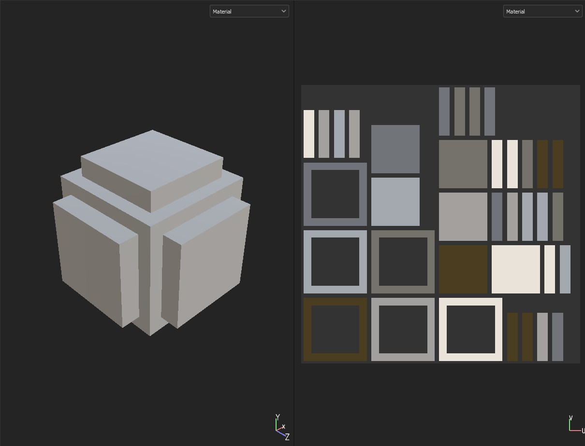

Загружаем нашу модель в Substance. И опять не видим здесь зеленого цвета. Для начала запечем нашу текстуру, взяв данные с объекта. Для этого нажмите *Edit - Bake Mesh Maps*

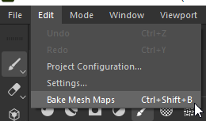

Поменяйте расширение текстур на более высокое качество, к примеру 1024.

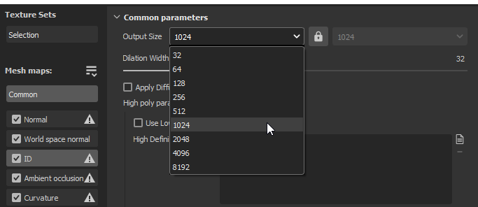

Выполните следующие действия, чтобы запечь материал на текстуру.

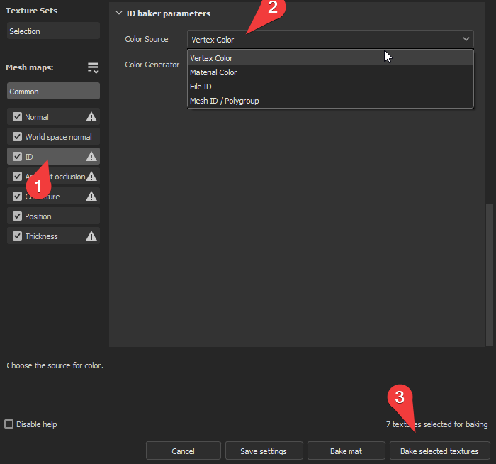

Зеленый цвет все еще не появился. Однако увидеть его можно поменяв режим отображения, выберем там *ID*

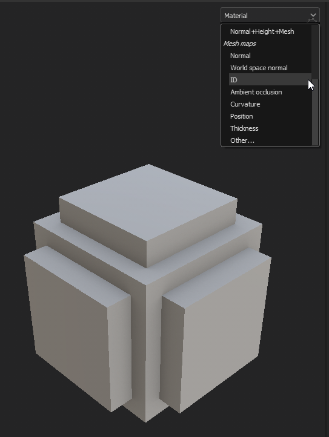
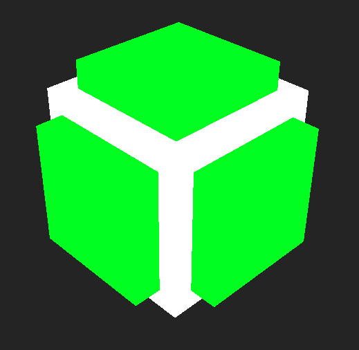

Вот и наш зеленый цвет. Что же нам с ним делать? Для начала вернемся в первоначальный режим отображения *Material* и создадим новый заливочный слой, пусть это будет дерево:

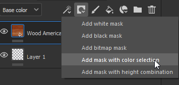

Добавим слой маску, но необычную, а *Mask with color selection* и в панели *Properties*, нажав *Pick Color* выберем наш зеленый цвет

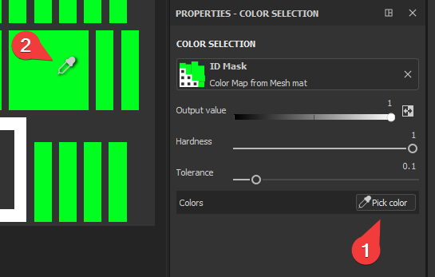

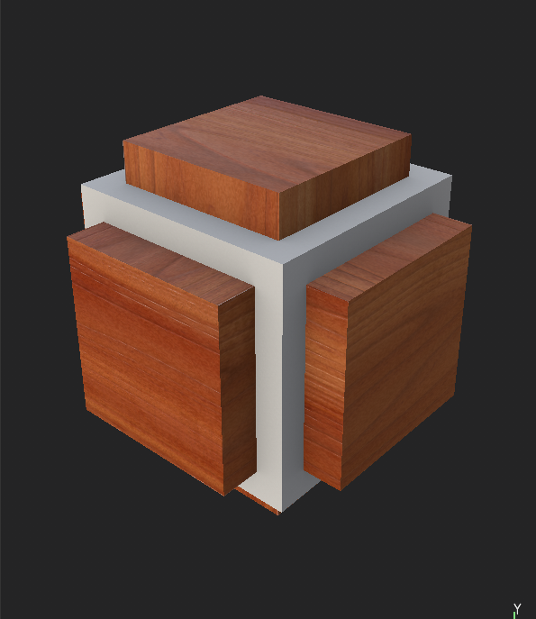

Получаем следующий результат!

Теперь, опираясь на это сделайте следующие модели и разукрасьте:
1. Дверь с металлической ручкой и глянцевыми стеклами
2. Топор, меч или молот, материал рукоятки которого отличается
3. Дискета с металлическими вставками
   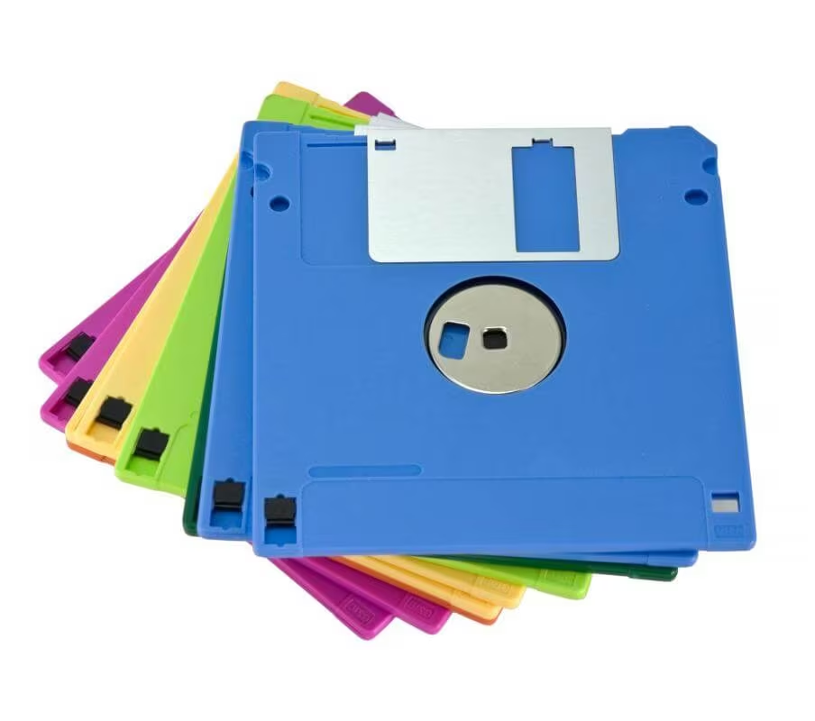
___

Критерии оценки
1 модель - 3
2 модели - 4
3 модели - 5