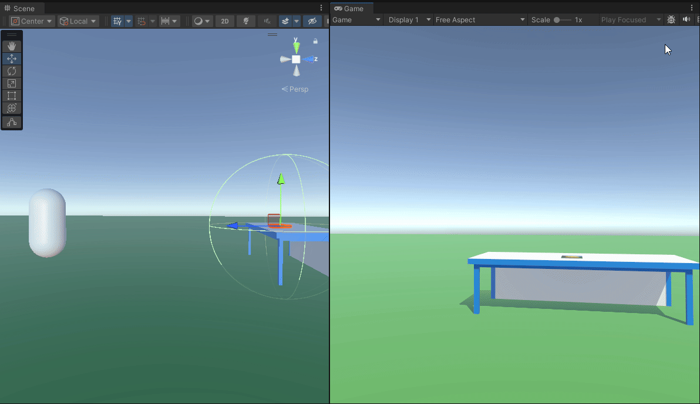
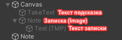
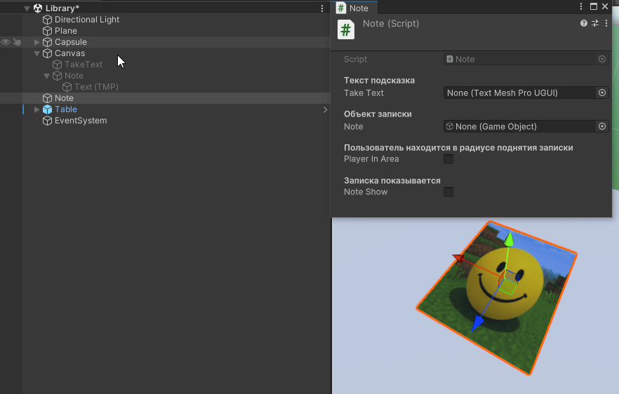

#### Введение

В вашей игре, вероятнее всего, потребуется реализация некоторых записок и/или других всплывающих окон интерфейса. В этой заметке я предоставлю вам один из вариантов того, как это можно реализовать.



#### Структура сцены

Начнем со структуры сцены:
- Игрок
- Canvas \[UI -> Canvas]
  Холст для расположения UI Объектов
	- TakeText \[UI -> TextMeshPro]
	  Текст с подсказкой – как взять записку
	- Note \[UI -> Image]
	  Сама записка. Белый прямоугольник или любое др. изображение
		- NoteText \[UI -> TextMeshPro]
		  Текст, отображающийся на записке
- Note \[3D -> Plane]
  Физический объект записки. Плоская бумажка, например




#### Скрипты
Для реализации этой идеи нам понадобится всего лишь один скрипт. Я назвал его Note. Вот его код
```c#
// Делаем компонент SphereCollider обязательным
[RequireComponent(typeof(SphereCollider))]
public class Note : MonoBehaviour
{
    [Header("Текст подсказка")]
    public TextMeshProUGUI takeText;
    [Header("Объект записки")]
    public GameObject note;

    [Header("Пользователь находится в радиусе поднятия записки")]
    public bool playerInArea = false;
    [Header("Записка показывается")]
    public bool noteShow = false;


    void Start()
    {
        // По умолчанию отключаем UI (интерфейс)
        takeText.gameObject.SetActive(false);
        note.gameObject.SetActive(false);
    }

    void Update()
    {
        // Если игрок не в радиусе записки, то ничего не делаем
        if (!playerInArea) return;

        // Иначе, если игрок в радиусе записки
        // и нажал клавишу Е, то мы показываем записку
        if(Input.GetKeyDown(KeyCode.E))
        {
            noteShow = !noteShow;
        }

        note.SetActive(noteShow);
    }

    private void OnTriggerEnter(Collider other)
    {
        // Если игрок входит в радиус записки
        if (other.gameObject.tag == "Player") {
            playerInArea = true;
            takeText.gameObject.SetActive(playerInArea);
        }
    }

    private void OnTriggerExit(Collider other)
    {
        // Если игрок выходит из радиуса записки
        if (other.gameObject.tag == "Player")
        {
            playerInArea = false;
            takeText.gameObject.SetActive(playerInArea);

            noteShow = false;
            note.SetActive(noteShow);
        }
    }
}
```
Все строки кода имеют пояснение в виде комментариев. И нам остается лишь настроить все это дело в Inspectore.

#### Настройка в Inspector'е
