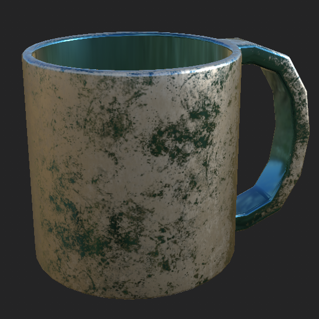
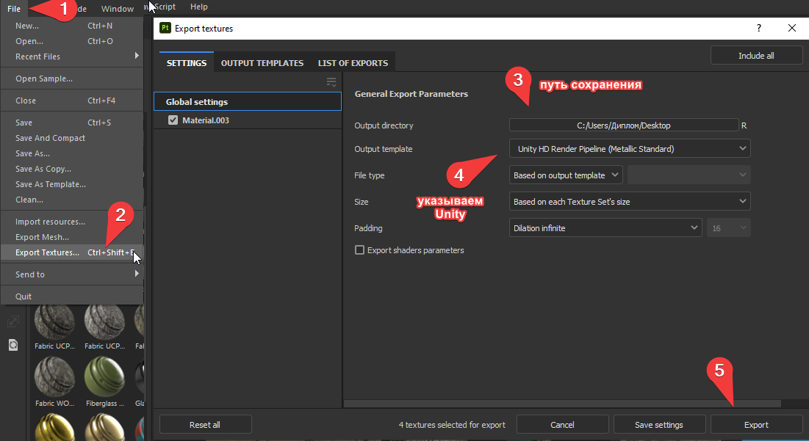
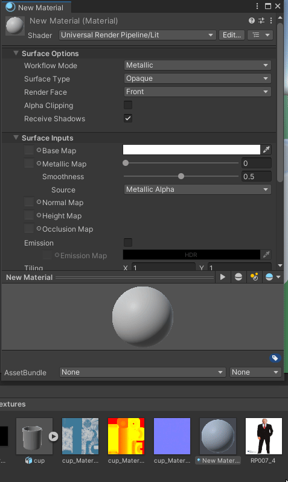
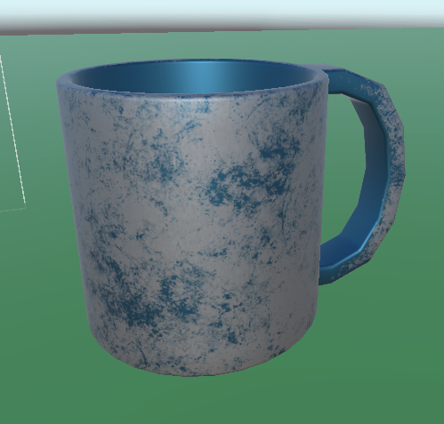

#### Введение
Разукрасили модель в Substance и хотите перенести их в Unity?

#### Инструкция

В месте сохранения у вас появится три текстуры:
- Base Color
- Metallic
- Normal

Переходим в Unity:
1. Переносим текстуры в папку проекта
2. Создаем новый материал
3. Присваиваем текстуры

4. Назначаем материал нашему объекту

#### Результат
