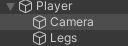
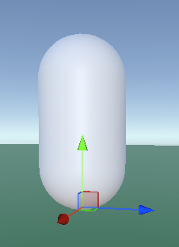

Скрипт `Movement.cs`. Добавляем его на персонажа
```c#
[RequireComponent(typeof(Rigidbody))]
public class Movement : MonoBehaviour
{
    private Rigidbody rb;
    private float mouseY = 0;
    private bool isGrounded = false;
    private Vector3 movement = Vector3.zero;

    [Header("Настройки движения")]
    public float moveSpeed = 3f;
    public float jumpPower = 5f;
    // Точка ног нашего персонажа
    public Transform legs;

    private void Start()
    {
        rb = GetComponent<Rigidbody>();
    }

    private void Update()
    {
        movement = Vector3.zero;

        // Касаемся ли земли
        isGrounded = Physics.Linecast(legs.position, legs.position + Vector3.down * 0.1f);

        // Считываем кнопки
        if (Input.GetKey(KeyCode.W)) movement.z = 1;
        if (Input.GetKey(KeyCode.S)) movement.z = -1;
        if (Input.GetKey(KeyCode.D)) movement.x = 1;
        if (Input.GetKey(KeyCode.A)) movement.x = -1;

        if (Input.GetKeyDown(KeyCode.Space) && isGrounded) rb.AddForce(transform.up * jumpPower);

        movement.Normalize();
        movement *= moveSpeed;
        rb.velocity = new Vector3(movement.x, rb.velocity.y, movement.z);
    }
}
```

Скрипт `MouseLook.cs` добавляем его на камеру внутри персонажа
```c#
public class MouseLook : MonoBehaviour
{
    public float mouseSensitivity = 100f;
    public Transform playerBody; // Сюда в инспекторе перетащите самого персонажа

    private float _yRotation = 0f;

    void Start()
    {
        // Прячем курсор мыши и блокируем его в центре экрана
        Cursor.lockState = CursorLockMode.Locked;
    }

    void Update()
    {
        // Получаем движение мыши по осям
        float mouseX = Input.GetAxis("Mouse X") * mouseSensitivity * Time.deltaTime;
        float mouseY = Input.GetAxis("Mouse Y") * mouseSensitivity * Time.deltaTime;

        // Вычисляем поворот по вертикали (вверх/вниз)
        _yRotation -= mouseY;
        // Ограничиваем угол, чтобы нельзя было сделать сальто головой (смотрим строго вверх или вниз)
        _yRotation = Mathf.Clamp(_yRotation, -90f, 90f);

        // Поворачиваем только камеру по вертикали
        transform.localRotation = Quaternion.Euler(_yRotation, 0f, 0f);

        // Поворачиваем ВСЕ тело персонажа по горизонтали (влево/вправо)
        playerBody.Rotate(Vector3.up * mouseX);
    }
}
```

Структура персонажа следующая:


Legs – это Empty (пустой) объект который мы размещаем у ног персонажа
