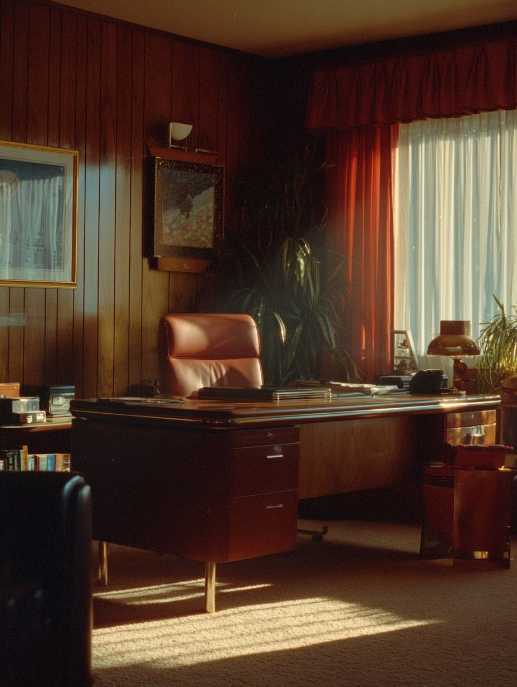
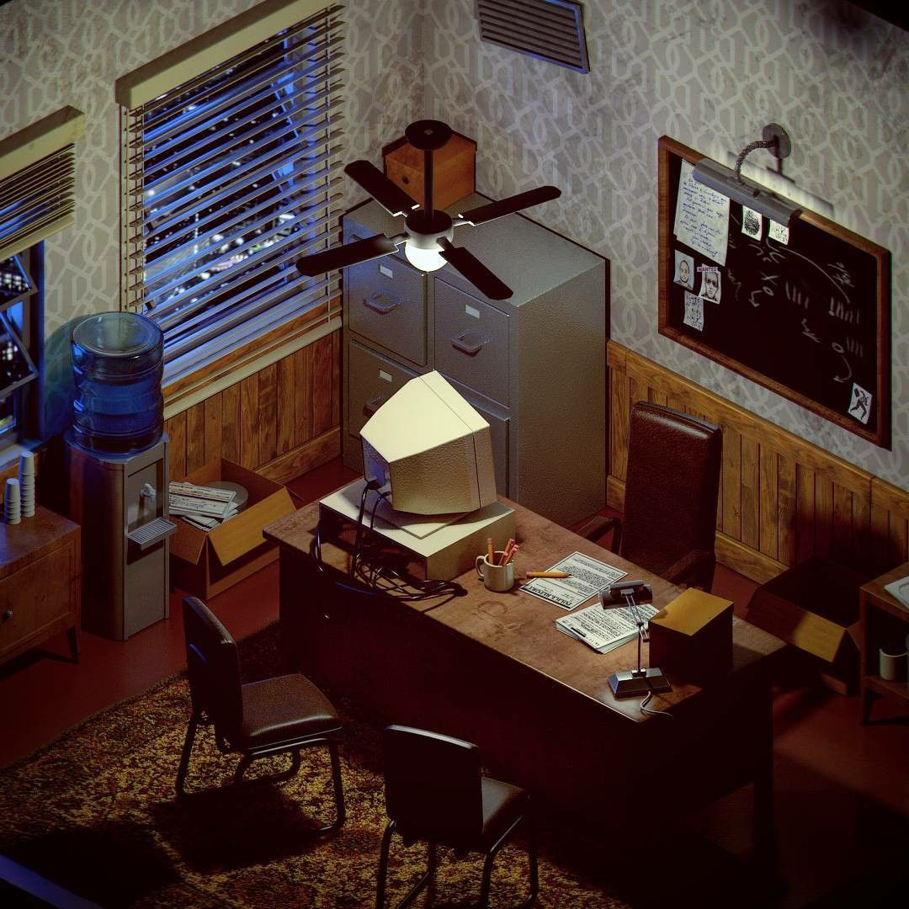
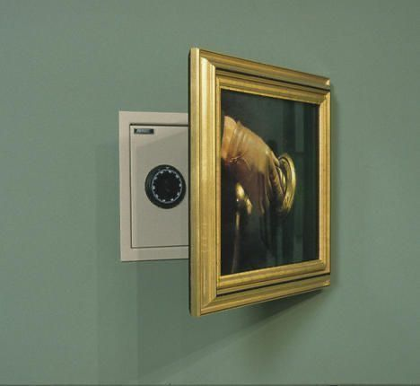
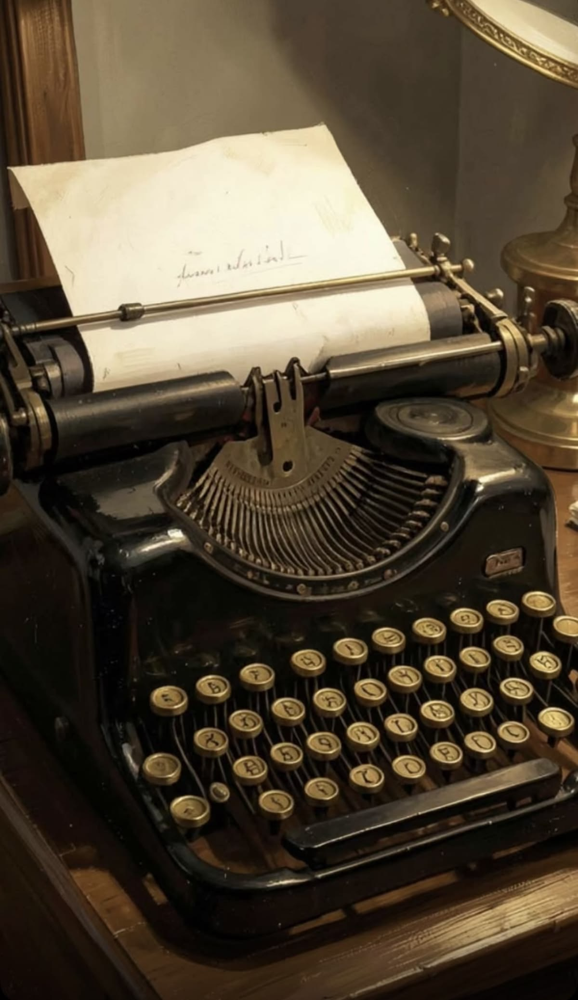

Карточка №1

# Требования:
- мин. 2 high-poly объекта запеченных на low-poly;
- мин. 2 анимированных объекта;
- все модели созданные в Blender;
- модели текстурированные с помощью Substance Painter;
- префабы;
- Mesh_ID (разукрашивание отдельных частей);
- отрисовка интерфейса;
- физика;

> Не знаешь как реализовать задуманное? Спроси преподавателя или одногруппника. ИИ в последнюю очередь, включи мозг

# Детективная загадка
### Чикаго 40ые годы. Вы частный детектив, который оказался заперт в собственном офисе. Вам предстоит выбраться через черный ход, отыскать код от потайного сейфа и включить старый лифт.

---

## Основные локации:
- Приемная для клиентов. Стекло с жалюзи, диван, картины
- Рабочий кабинет детектива. Много бумаг, печатная машинка, настольная лампа, сейф за картиной
- Склад. Архивные стеллажи, генератор, шахта лифта

## Основные объекты:
- Дверь. Деревянная со стеклом и надписью "Частный детектив"
- Старая печатная машинка с утраченной клавишей
- Генератор. Находится на складе и питает офис электричеством в случае аварии
- Канистра бензина
- Сейф с кодовым замком
- Связка ключей
- Лифт

## Сюжет пошагово:
1. Вы появляетесь в приемной своего кабинета и видите, что вокруг темно. Вы ничего не помните, свет отключен а парадная дверь заперта. Вы решаетесь восстановить питание, пройдя на склад и активировав генератор. Действие должно сопровождаться соблюдением условия – заправкой генератора
2. Вы находите на складе канистру бензина и генератор. Заливаете бензин в генератор и запускаете аварийное электропитание. В свете ламп вы видите заметку у шахты лифта "Код от сейфа – AGUQ на машинке". Этот текст писали вы, но ничего о нем не помните.
3. На вашем рабочем столе находится печатная машинка, но одна из кнопок утеряна. Это кнопка "Q". Через время вы находите её копошась в ящиках. Вставив клавишу на место, вы набираете на ней "AGUQ" и на листке вдруг появляются цифры "8190".
4. Порыскав в кабинете ещё какое-то время, за картиной вы находите сейф встроенный в стену. Набрав код "8190", он открывается и там лежит связка ключей. Один из ключей подходит к скважине замка шахты лифта.
5. Вы открываете лифт, нажимаете первый этаж и игра пройдена.

