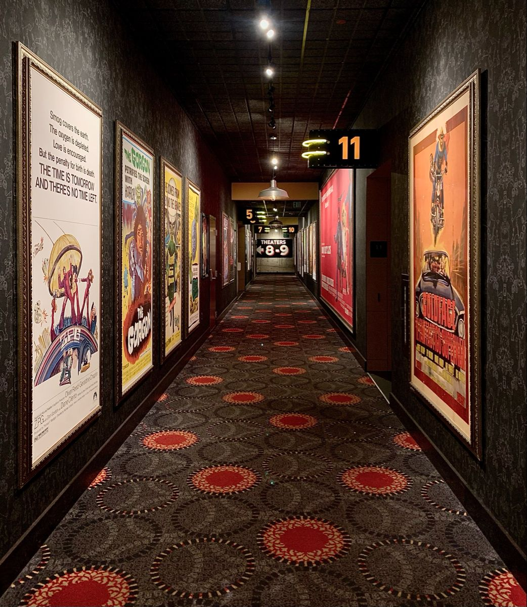
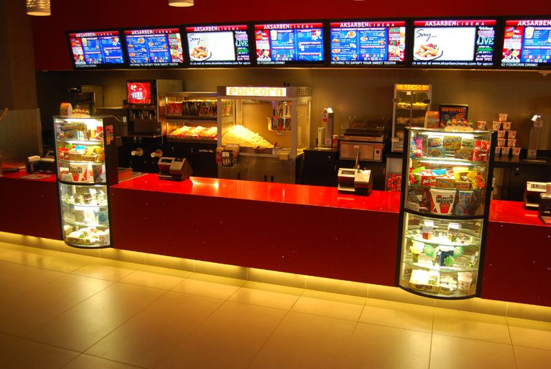
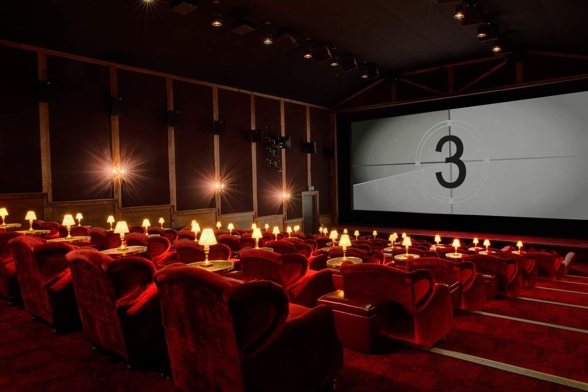

Карточка №2

# Требования:
- мин. 2 high-poly объекта запеченных на low-poly;
- мин. 2 анимированных объекта;
- все модели созданные в Blender;
- модели текстурированные с помощью Substance Painter;
- префабы;
- Mesh_ID (разукрашивание отдельных частей);
- отрисовка интерфейса;
- физика;

> Не знаешь как реализовать задуманное? Спроси преподавателя или одногруппника. ИИ в последнюю очередь, включи мозг

# Последний сеанс
### Старый кинотеатр давно закрыт. Вы оказались внутри здания после того, как за вами захлопнулась входная дверь. Чтобы выбраться, придётся восстановить работу кинопроектора и найти способ открыть служебный выход.

---

## Основные локации:
- Кассовый зал. Окно кассы, стойка с билетами, афиши, входные двери.
- Зрительный зал. Ряды кресел, большой экран, проходы между рядами, дверь в аппаратную.
- Проекционная. Старый кинопроектор, катушки с плёнкой, рабочий стол, электрический щиток.

## Основные объекты:
- Касса с выдвижным ящиком.
- Старый билет с частью шифра.
- Кинопроектор с вращающимися катушками.
- Катушка с киноплёнкой.
- Электрический щиток.
- Настенный выключатель.
- Экран в зрительном зале.
- Дверь служебного выхода с кодовым замком.

## Сюжет пошагово:
1. Вы появляетесь в кассовом зале. Главный выход заперт, а служебная дверь закрыта электронным замком. В здании работает только аварийное освещение.
2. В кассе вы находите старый билет с номером сеанса. Этот номер пригодится для открытия ящика в проекционной.
3. В проекционной вы открываете ящик, набрав номер с билета, забираете катушку с киноплёнкой и устанавливаете её в проектор. Однако проектор не запускается из-за отключённого питания.
4. Вы включаете электрический щиток, запускаете проектор и направляете изображение на экран. На экране появляется кадр с четырьмя цифрами, которые образуют код служебного выхода.
5. Вы возвращаетесь в кассовый зал, вводите код на замке и открываете дверь. Кинотеатр остаётся позади, а игра завершается.

