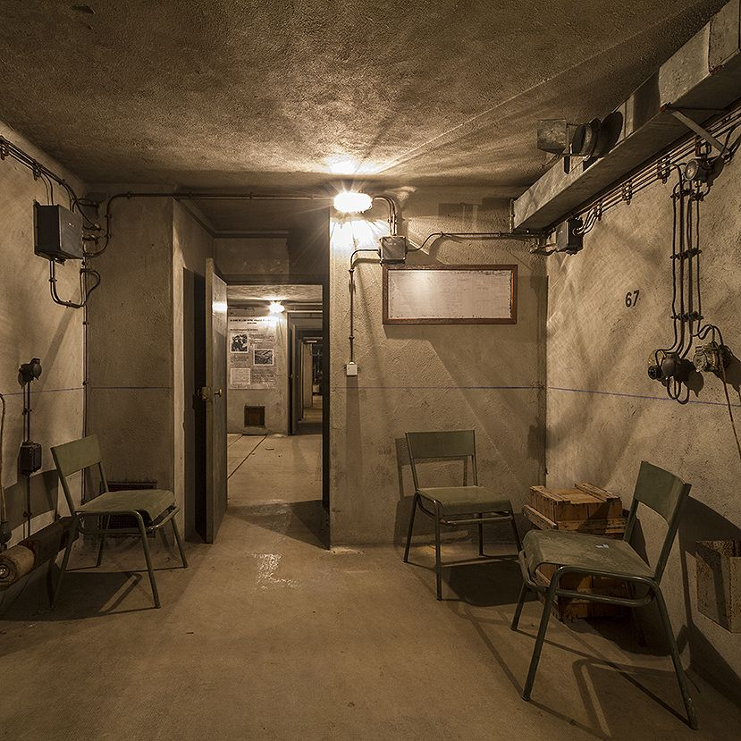
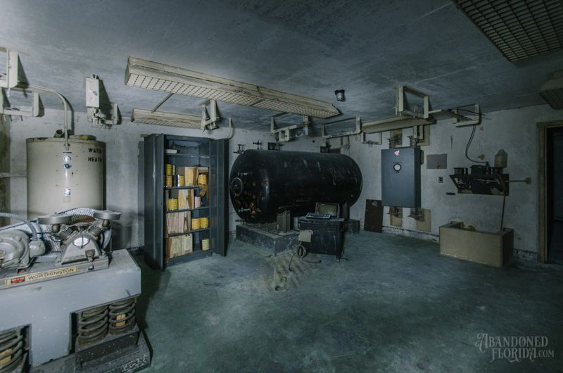
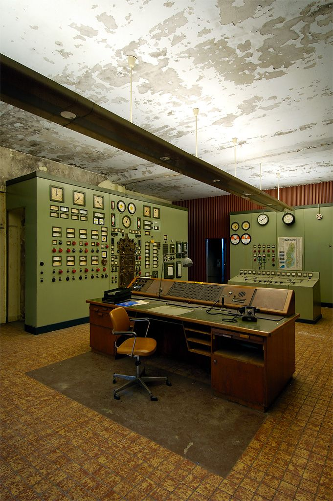
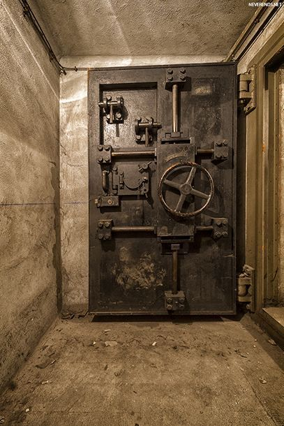

Карточка №3

# Требования:
- мин. 2 high-poly объекта запеченных на low-poly;
- мин. 2 анимированных объекта;
- все модели созданные в Blender;
- модели текстурированные с помощью Substance Painter;
- префабы;
- Mesh_ID (разукрашивание отдельных частей);
- отрисовка интерфейса;
- физика;

> Не знаешь как реализовать задуманное? Спроси преподавателя или одногруппника. ИИ в последнюю очередь, включи мозг

# Бункер
### Вы техник, запертый в старом бункере после аварии. Питание отключено, гермодверь заблокирована. Нужно запустить резервный генератор, найти код от панели управления и открыть дверь.

---

## Основные локации:
- Комната управления. Пульт, мигающая лампочка, стол с бумагами.
- Склад. Стеллажи с инструментами, канистра, генератор.
- Тамбур. Гермодверь с кодовым замком, вентиляция.

## Основные объекты:
- Резервный генератор.
- Канистра с бензином.
- Записка с подсказкой (появляется при свете).
- Кодовая панель на гермодвери.
- Гермодверь.
- Фонарик.

## Сюжет пошагово:
1. Вы приходите в себя в тёмной комнате управления. Дверь заперта, света нет. Вспоминаете, что на складе есть резервный генератор.
2. На складе находите канистру с бензином и генератор. Заправляете и запускаете его — загорается свет.
3. При свете на столе в комнате управления обнаруживаете записку: «Код — сумма цифр на панели генератора». На генераторе видна гравировка «3+7+9».
4. Возвращаетесь к гермодвери и набираете код «19» на панели. Замок щёлкает, дверь открывается. Игра пройдена.

